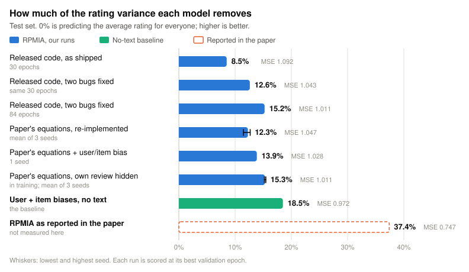
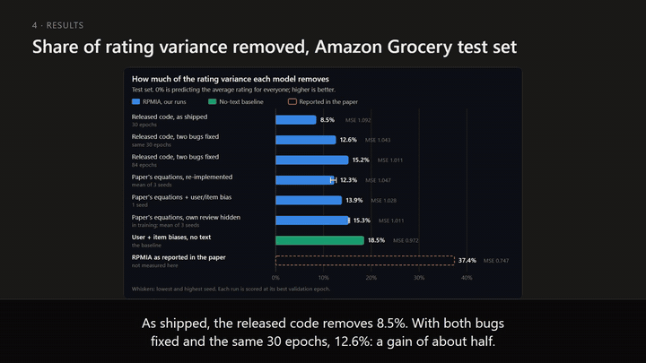
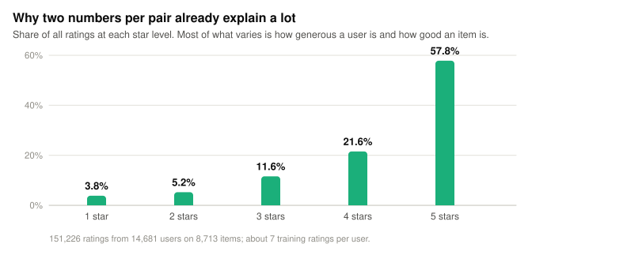
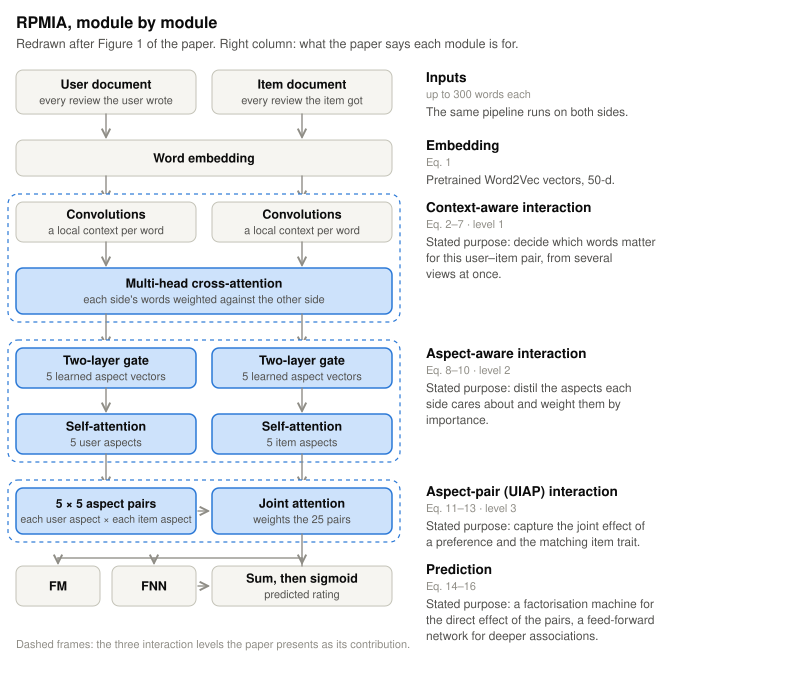
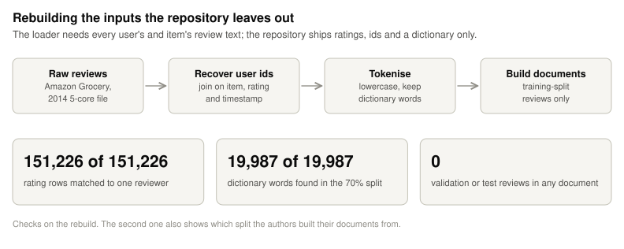
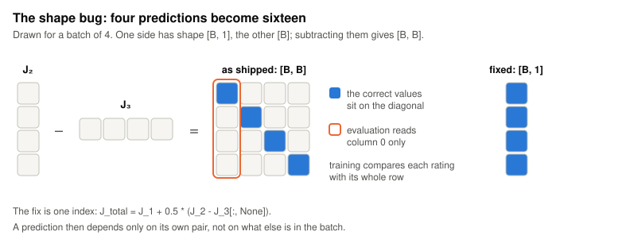
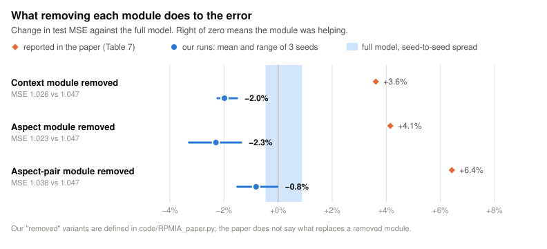
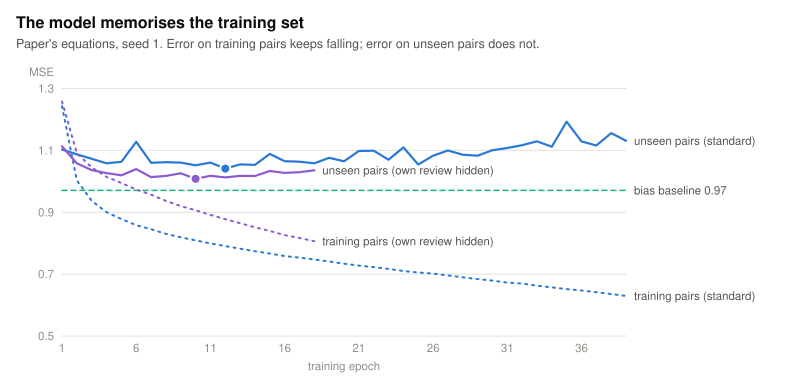

# Reproducing a review-based rating model: two bugs, an ablation, and a baseline with no text

I reran RPMIA, a 2025 model that predicts a user's star rating for a product from review text, on the
dataset and split its authors released. With the released code repaired and the paper's equations
re-implemented, the model removes about **12% of the rating variance** on unseen pairs. A baseline
that never reads a review, just "this user's average plus this product's average", removes **18.5%**.
Removing any one of the model's three interaction modules did not make it worse.

<picture>
  <source media="(prefers-color-scheme: dark)" srcset="figures/ladder_dark.svg">
  
</picture>

The paper is Yu, Gong, Zhang, Ding and Fu, *From Interaction to Prediction: A
Multi-Interactive Attention-Based Approach to Product Rating Prediction*, INFORMS Journal on Computing, 2025
([doi:10.1287/ijoc.2023.0131](https://doi.org/10.1287/ijoc.2023.0131)), with code at
[INFORMSJoC/2023.0131](https://github.com/INFORMSJoC/2023.0131). I treated it as study material: the
aim was to learn what each part of such a model contributes on real data, and why, more than to match
a number in a table.

A narrated walk-through of the same material, about five and a half minutes with English captions:
[`media/walkthrough.webm`](media/walkthrough.webm).

[](media/walkthrough.webm)

## What I found

- **The released code has two one-line bugs, and as shipped its predictions ignore the review
  text.** A misplaced bracket gives one regularisation term 1000 times its intended weight, and a
  shape mismatch turns a batch of B predictions into a B × B matrix. On a checkpoint of the code as
  shipped, shuffling every review document left the test error unchanged to eight digits. Repairing
  the bracket makes the text matter; repairing the shape then improves the score.
- **Fixing both lifts the released model from 8.5% to 12.6% of variance removed** at the same 30
  epochs, a gain of about half. Training on to 84 epochs reaches 15.2%.
- **The paper's equations describe a different network from the released code.** I re-implemented
  them, marking every place where the paper is silent. That version removes 12.3% (three seeds,
  11.5% to 12.7%).
- **Removing a module never raised the error.** Without the context module the test error is 2.0%
  lower, without the aspect module 2.3% lower, and without the aspect-pair module it is within the
  seed-to-seed spread. The paper reports +3.6%, +4.1% and +6.4% for the same three removals.
- **The model memorises.** At its best epoch the error on training pairs is 0.79 and on unseen pairs
  1.04. One cause is tested: during training each pair's own review sits inside both input
  documents. Hiding it lowers the test error by 3.5% and closes most of that gap.
- **No variant reaches the no-text baseline**, and none comes near the 37.4% the paper reports for
  this dataset. Under these conditions (the released split, rebuilt inputs, three seeds) that figure
  was not reproduced.

## How to read the scores

The usual score is mean squared error (MSE) in stars squared, lower is better. On its own that number
says little, so the text mostly uses a relative one:

> **share of variance removed** = 1 − MSE ÷ MSE of always predicting the average rating

Always predicting the average scores 0%. A perfect model scores 100%. On this test set the average
rating has an MSE of 1.193, so a model at MSE 1.047 removes 12.3%. Differences between two models are
given as a relative change in test MSE, where negative means better.

Every run is scored the same way: the epoch with the lowest validation error is chosen, and the test
error of that epoch is reported. The released script instead prints the test error of every epoch, so
I held out the validation rows the repository already ships and trained on the remaining 70%.

### Why "user average plus product average" is the bar

<picture>
  <source media="(prefers-color-scheme: dark)" srcset="figures/ratings_dark.svg">
  
</picture>

58% of the 151,226 ratings are five stars. Most of what can be predicted is therefore two facts: some
users rate higher than others, and some products are liked more than others. A model with one number
per user and one per product captures both, fits in seconds, and removes 18.5% of the variance
(validation MSE 0.971, test 0.972). I use it as the bar for one reason: a model that reads reviews
has to beat it before it can claim the text added anything.

It is a bar and not a limit. Matrix factorisation tuned on the same validation rows did no better
here (0.970 to 0.971 over three seeds), but stronger models with and without text exist. The paper's own
comparison table lists models down to an MSE of 0.75 on this dataset.

## The model

<picture>
  <source media="(prefers-color-scheme: dark)" srcset="figures/architecture_dark.svg">
  
</picture>

Each user is represented by the reviews they wrote, joined into one document of up to 300 words, and
each product by the reviews written about it. RPMIA processes the two documents in parallel and lets
them interact at three levels:

1. **Context.** A convolution turns each word into a context vector. Cross attention then re-weights
   the user's words by how well they match the product's document, and the reverse.
2. **Aspect.** A gate projects each side into five "aspects" (the paper's examples are price,
   taste, packaging), and self attention pools each aspect into one vector.
3. **Aspect pair.** All 5 × 5 combinations of a user aspect and a product aspect are formed and
   weighted by a joint attention, so that "this user cares about price" can meet "this product is
   expensive".

A factorisation machine and a small feed-forward network turn the weighted pairs into a rating. The
released code is derived from an earlier model, CARP, and shares its data format and loader.

## Rebuilding the missing inputs

<picture>
  <source media="(prefers-color-scheme: dark)" srcset="figures/rebuild_dark.svg">
  
</picture>

The repository ships the rating splits and the vocabulary, but not the two review-document files
the loader reads, and not the user-id mapping needed to build them. `code/build_reviews.py` rebuilds
them from the public Amazon 2014 "Grocery and Gourmet Food" 5-core file:

- Raw reviews are joined to the repository's rating rows on product, rating and timestamp. All
  **151,226 of 151,226** rows match exactly one review, which recovers the user ids.
- The paper does not say which reviews the documents were built from. `code/check_vocab.py` settles
  it: tokenising only the 70% training reviews yields exactly the **19,987 words** of the shipped
  vocabulary, while every other candidate set yields 11 to 13 extra words.
- The paper asks for pretrained 50-dimensional Word2Vec vectors without naming a source.
  `code/train_w2v.py` trains them on the training documents only.

The review text itself is not in this repository. The scripts regenerate it from the original files.

## Two bugs in the released code

<picture>
  <source media="(prefers-color-scheme: dark)" srcset="figures/broadcast_dark.svg">
  
</picture>

**A misplaced bracket.** The loss multiplies the regularisation terms by λ = 0.001, but the bracket
closes early. The penalty on the convolution, gate and projection weights, which are the weights
that read text, enters the loss with weight 1. That is 1000 times the intended strength and pushes
those weights toward zero.

**A shape mismatch.** In the factorisation machine one term has shape `[B, 1]` and the term subtracted
from it, a `tf.trace`, has shape `[B]`. TensorFlow broadcasts the difference to `[B, B]`, so each
example's prediction is mixed with a term from every other example in the batch. The repair is
`J_2 - J_3[:, None]`.

To see whether a trained model uses text at all, I score the test set twice: once normally, and once
with the review documents shuffled between users and between products.

| Model | Test MSE, real documents | Test MSE, shuffled documents |
|---|---|---|
| Released code as shipped (epoch-12 checkpoint) | 1.13017584 | 1.13017584 |
| Bracket repaired | 1.139 | 1.219 |
| Both repairs (84-epoch run) | 1.011 | 1.288 |
| Paper's equations, re-implemented | 1.042 | 1.548 |

As shipped, the predictions do not depend on the text. Repairing the bracket alone is enough to
change that. The shape repair is what then improves the score.

`code/make_run.py` applies each repair to the authors' file as a separate flag and asserts that it
changed exactly one place. `code/released_harness.diff` shows everything else that differs from the
released script, which is logging and validation only.

## Results

| Model | Test MSE | Variance removed | Notes |
|---|---|---|---|
| Predict the average rating | 1.193 | 0% | the zero point |
| Released code, as shipped | 1.092 | 8.5% | 30 epochs, still improving |
| Released code, bracket repaired only | 1.106 | 7.4% | 13 epochs, not length-matched |
| Released code, both repairs | 1.043 | 12.6% | same 30 epochs |
| Released code, both repairs | 1.011 | 15.2% | 84 epochs, best at 70 |
| Paper's equations | 1.047 | 12.3% | 3 seeds, 1.042 to 1.056 |
| Paper's equations + user and item bias | 1.028 | 13.9% | 1 seed |
| Paper's equations, own review hidden in training | 1.011 | 15.3% | 3 seeds, 1.009 to 1.012 |
| **User + product averages, no text** | **0.972** | **18.5%** | the bar |
| RPMIA as reported in the paper | 0.747 | 37.4% | not measured here |

Two cautions on reading this table. The 8.5% to 12.6% step compares equal training lengths, and both
of those runs were still improving when they stopped. And rows with one seed should be compared with
the three-seed range of the full paper-equation model, which spans about 1.4% in test MSE.

## Does each module help?

<picture>
  <source media="(prefers-color-scheme: dark)" srcset="figures/ablation_dark.svg">
  
</picture>

Each variant was trained three times with the same settings as the full model.

| Removed | Test MSE, 3 seeds | Change vs full model (1.047) | Paper reports |
|---|---|---|---|
| nothing (full model) | 1.042, 1.042, 1.056 | −0.5% to +0.9% | |
| Context module (cross attention) | 1.031, 1.023, 1.024 | **−2.0%** | +3.6% |
| Aspect module (gate and self attention) | 1.012, 1.032, 1.023 | **−2.3%** | +4.1% |
| Aspect-pair module (5 × 5 pairing) | 1.031, 1.037, 1.047 | −0.8% | +6.4% |

- **Context and aspect:** all three seeds of each variant score better than all three seeds of the
  full model. On this data, these two modules cost a little accuracy.
- **Aspect pair:** the range overlaps the full model's. No measurable effect.

The explanation I find most likely is capacity. The network already fits the training pairs far
better than unseen ones, and each module adds parameters and attention paths that help it do so (the
full model has 1.98 million parameters; the three variants have 1.44, 1.05 and 1.32 million). With
109,000 training ratings and 300-word documents there is not enough signal for the extra structure to
pay for itself. The next section tests part of this. For the aspect-pair module there is a second,
simpler reason: the factorisation machine that follows it already models pairwise interactions
between everything it receives, so explicit pairing gives it little it did not have.

The paper does not say what replaces a removed module, so these definitions are mine: without the
context module the convolution outputs go straight on; without the aspect module each side becomes
one attention-pooled vector; without the aspect-pair module the ten aspect vectors are concatenated.
A different choice could give different numbers. With three seeds and effects of 2%, the sign is
reasonably safe for the first two rows and the size is not.

## Why it stays below the baseline

<picture>
  <source media="(prefers-color-scheme: dark)" srcset="figures/curves_dark.svg">
  
</picture>

Four candidate reasons, with what I did and did not test.

| Reason | Tested? | Evidence |
|---|---|---|
| The paper's prediction layer has no user or product bias | suggestive, 1 seed | adding them: 12.6% → 13.9% on the same seed |
| In training, each pair's own review is in both documents | yes, 3 seeds | hiding it: 12.3% → 15.3%; train error at best epoch 0.79 → 0.91 |
| Other people's reviews say little that the averages do not | no | consistent with the results; see below |
| The baseline was tuned on validation, the model's open choices were not | no | |

**No bias terms.** Equation 14 of the paper predicts from text features alone. The single strongest
signal in this dataset, a user's and a product's own average, has to be re-learned through the text
path. Adding the two bias terms lowered the test error by 1.4% on the one seed I ran, which is about the
size of the seed-to-seed spread, so I count it as suggestive. The released code does include them, which
may be one reason it keeps up with the re-implemented equations.

**The answer is in the input, but only in training.** A user's document is built from their training
reviews, and one of those is the review of the very product being predicted. The same holds on the
product side. That review states the rating almost outright, so the network learns to look for it.
For validation and test pairs it is not there. When I rebuild both documents for every training pair
without that one review (it changes the user document for 77,231 of 108,743 pairs and the product
document for 52,027), the training error at the best epoch rises from 0.79 to 0.91 and the test
error falls by 3.5%. Validation and test documents are identical in both setups.

**What is left for text to add.** With the leak removed the model still trails the baseline. At
prediction time it sees what this user wrote about other products and what other people wrote about
this product, cut to 300 words a side. Much of what that text conveys, that the user is generous or
the product is well liked, is what the two averages already encode. I did not test this directly.
It matches an earlier finding in the literature that review-based recommenders often fail to beat
simple baselines under a controlled comparison (Sachdeva and McAuley, *How Useful are Reviews for
Recommendation? A Critical Review and Potential Improvements*, SIGIR 2020).

## What I take from this

- **Fit the trivial baseline first, and report relative to it.** "MSE 1.04" looked fine until it sat
  next to "0.97 with no text". Without the baseline, every later number would have been read wrong.
- **Check that the model uses its input.** The shuffle test takes a minute and found a released
  model whose predictions ignored the text it was built to read.
- **Compare at equal training length.** My first reading was that the two repairs nearly doubled the
  score. At equal length the gain is about half.
- **Published ablations show that a full model beat its parts once, in one setup.** Here the sign
  flipped. Run the ablation on your own data before paying for the complexity.
- **Look for the target in the features.** Building user and product documents from all training
  reviews is standard in this line of work, and it puts each training label's own review into its
  input.
- **A paper's code and its equations can be two different models.** Decide which one you are
  reproducing, and write down every gap you had to fill.

## Limits

- One dataset, one split (the authors'), and inputs rebuilt by me. The vocabulary check shows the
  documents come from the right reviews; it cannot show the authors ordered or truncated them the same
  way.
- Three seeds for the ablation and the full model; one seed for the released-code runs and the bias
  variant.
- The paper leaves several choices open (number of attention heads, dropout placement, the form of one
  aspect-pair term, the Word2Vec source). `code/RPMIA_paper.py` lists each one in its header. All were
  fixed before any test result was seen and none was tuned.
- I did not try to find out why the paper's figure is higher. The differences I know of are listed
  above; I cannot say which of them, if any, accounts for it.

## Run it

Everything ran on a single Colab T4 GPU with TensorFlow 1.15 on Python 3.7. A paper-equation run
takes 12 to 28 minutes.

```bash
mkdir -p /root/rpmia && cp code/* /root/rpmia/   # the scripts expect to live here
bash /root/rpmia/setup_env.sh gpu   # clones the authors' repo at 564c27c, builds the env, downloads the raw file, rebuilds the inputs
python results/summarize.py         # per-epoch records -> results/summary.json and the table above
python figures/make_figures.py      # summary.json -> figures/*.svg
```

I have not rerun these steps from a fresh clone of this repository; the runs here were launched from
the same scripts in a working folder. `RPMIA_paper.py` and the Word2Vec file from `train_w2v.py` go
into the authors' `src/` tree before a paper-equation run. Single runs are started with `code/launch_run.sh`, the ablation and own-review-hidden sets
with `code/ablation_queue.sh`, and the shuffle test with `code/probe_run.sh`. `results/README.md` maps each
row of the tables to a run folder.

## Layout

```
code/      scripts: input rebuild, the two repairs, the re-implementation, baselines, run queues
results/   one folder per run with its per-epoch record, plus summarize.py and summary.json
figures/   make_figures.py and the SVGs it writes, in a light and a dark version
media/     the walk-through video and its preview
```

## Who did what

I chose the paper, set the questions and decided what counted as an answer. Claude (Anthropic's
coding agent) wrote the scripts, ran the experiments, drafted this text and built the video under that
direction. The video's narration is a synthetic voice. A
second model reviewed the claims, and several were weakened as a result.

## Licence

MIT, see [LICENSE](LICENSE). `code/make_run.py` and `code/released_harness.diff` patch the authors'
MIT-licensed `src/RPMIA.py`, which is not copied here. The Amazon review data is not redistributed.
